# Asset Pro — Manual de instruções

Data: 15 de outubro de 2026.  
As figuras são prints do tablet e do desktop.

O Asset Pro inventaria equipamentos de subestações elétricas. O escritório sobe a base, designa as instalações e acompanha o retorno. O inventariante, no tablet, compara o pátio com a base, tira foto e devolve a visita. A saída é uma planilha `.xlsx` e as fotos em pastas no SharePoint.

Na tela, o conjunto de instalações se chama **Projeto**. No SharePoint, a lista se chama **Campanhas**.

A documentação dos campos, das listas e dos fluxos continua em [Asset-Pro-manual.md](Asset-Pro-manual.md).

---

## Arquivos para download

Os instaladores e a planilha modelo ficam nesta pasta do SharePoint:

[Documentos Compartilhados / AssetPro](https://assetexpertsdados.sharepoint.com/sites/AssetPro493/Documentos%20Compartilhados/Forms/AllItems.aspx?id=%2Fsites%2FAssetPro493%2FDocumentos%20Compartilhados%2FAssetPro&viewid=40b0572b%2D91d9%2D4e1c%2D9bdb%2D6abc4e60d514)

Site `AssetPro493`, biblioteca **Documentos Compartilhados**, pasta **AssetPro**.

| Arquivo | Para quê |
|---------|----------|
| `AssetProDesktop-Setup.exe` | Instalador do aplicativo de escritório, no Windows |
| `Asset-Pro-Mobile.apk` | Aplicativo de campo, no tablet Android |
| `base-modelo-para-importacao.xlsx` | Planilha modelo da base. É este formato que o **Importar projeto** lê |

---

## 1. Quem usa

| Papel | Onde entra | O que faz |
|-------|------------|-----------|
| Escritório | App no navegador | Cadastra o slot, importa a planilha, designa subestações, consulta o que voltou, finaliza o projeto e baixa a planilha |
| Inventariante | App no tablet | Entra com o slot, baixa o que foi designado, levanta a subestação e envia a visita |

Uma conta Microsoft abre o tablet. Quem está em campo naquele dia entra com um **slot** (login e senha cadastrados pelo escritório). Vários prestadores revezam o mesmo aparelho.

Os dois perfis entram no tablet. O slot **Escritório** vê todas as campanhas e todas as subestações, inclusive as que ainda não foram designadas. O slot **Inventariante** vê só as campanhas e as subestações designadas para ele.

---

## 2. Como o trabalho anda

```text
Escritório cadastra o slot
        ↓
Importa a planilha (.xlsx)  →  projeto Pendente
        ↓
Designa as subestações
        ↓
Inventariante baixa os dados (com sinal)
        ↓
Em campo: ficha, foto, finalizar a subestação (pode ser sem sinal)
        ↓
Envia a visita (com sinal)  →  projeto Em andamento
        ↓
Escritório confere subestações, fichas e fotos
        ↓
Finaliza o projeto (só se toda subestação estiver Finalizada)  →  Concluído
        ↓
Baixa a planilha. As fotos já estão nas pastas.
```

| Onde | Valor | Significado |
|------|--------|-------------|
| Projeto | Pendente | Importado. Nenhuma visita enviada |
| Projeto | Em andamento | Pelo menos uma visita já subiu |
| Projeto | Concluído | O escritório finalizou, e nenhuma subestação está aberta |
| Subestação | Pendente | Ainda não levantada |
| Subestação | Finalizada | O inventariante encerrou aquela instalação |

**Concluído** só nasce no desktop, no botão **Finalizar projeto**, e só se toda subestação estiver **Finalizada**. Enviar a visita grava o projeto como **Em andamento**. Não conclui o projeto.

No tablet, a sequência de rede é manual: **Baixar dados** (com sinal) → levantamento → **Finalizar** a subestação → **Enviar visita** (com sinal). Salvar a ficha grava no aparelho. O SharePoint recebe a ficha no envio.

Uma subestação tem um inventariante por vez.

---

## 3. Escritório

Entre no app pelo navegador, com a conta do escritório. A marca no canto do menu é **assetexperts**.

O menu lateral, de cima para baixo:

| Item | Para quê |
|------|----------|
| **Home** | Visão dos projetos e os números do dia |
| **Importar / Exportar** | Sobe a planilha do projeto, baixa a planilha de saída e exclui |
| **Conferência** | Próxima etapa. Ainda não entra neste manual |
| **Inventários** | Coleta no escritório, no mesmo caminho do tablet |
| **Usuários** | Slots de quem entra no tablet |

Embaixo do menu: **Light** e **Dark** trocam o tema. **Atualizar**, no canto superior direito, recarrega a tela que está aberta.

### 3.1 Home

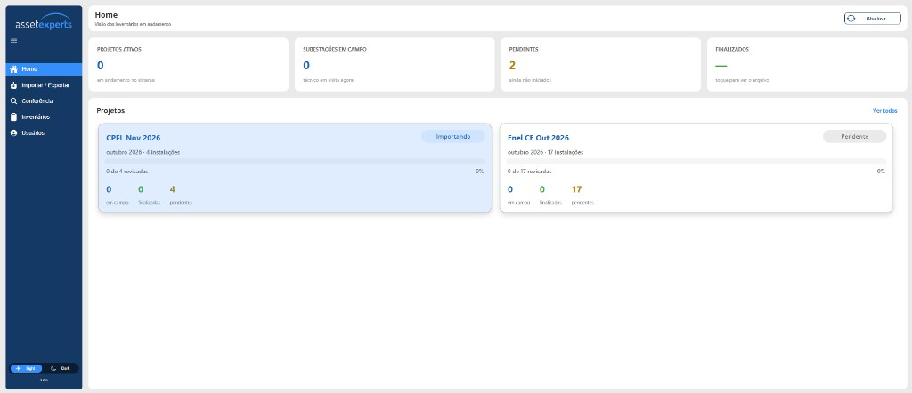

O título é **Home**. O subtítulo é **Visão dos inventários em andamento**.

Quatro cartões no topo:

| Cartão | O que mostra |
|--------|----------------|
| **PROJETOS ATIVOS** | Quantos projetos estão em andamento. |
| **SUBESTAÇÕES EM CAMPO** | Quantas instalações têm técnico em visita agora. |
| **PENDENTES** | Quantas ainda não foram iniciadas. |
| **FINALIZADOS** | O traço aparece quando ainda não há projeto encerrado para o arquivo. |

Abaixo, **Projetos**. **Ver todos**, à direita, abre a lista completa.

Cada card:

| Parte | O que é |
|-------|---------|
| Nome | No exemplo, **CPFL Nov 2026** e **Enel CE Out 2026**. |
| Linha cinza | Mês, ano e quantas instalações. |
| Chip | **Importando** enquanto a planilha ainda está entrando. **Pendente** quando a carga acabou e nenhuma visita foi enviada. |
| Barra | Revisadas sobre o total, com a porcentagem. |
| Três números | Em campo, finalizadas e pendentes. |

O clique no card abre as subestações daquele projeto.

### 3.2 Usuários

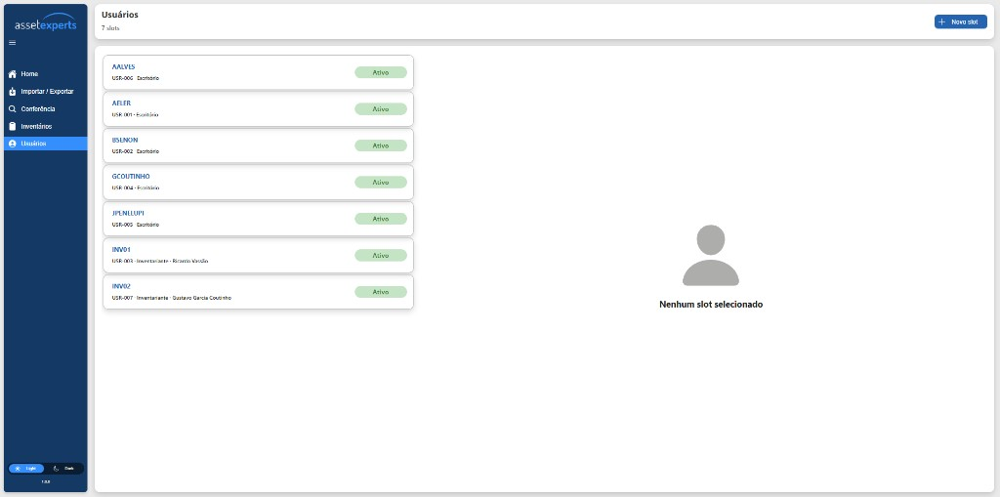

A tela lista os slots. No exemplo, **7 slots**. Cada linha mostra o login, o código (`USR-001`, `USR-003`…), o perfil e o chip **Ativo**.

| Perfil na linha | O que significa |
|-----------------|-----------------|
| **Escritório** | Entra no navegador e no tablet. No tablet vê todas as campanhas e todas as subestações. |
| **Inventariante · nome** | Entra no tablet. Vê só as campanhas e as subestações designadas para esse slot. O nome é quem está com o aparelho. |

Sem clique, o painel da direita diz **Nenhum slot selecionado**.

**Novo slot**, no canto superior direito, abre o mesmo painel em branco para criar outro login.

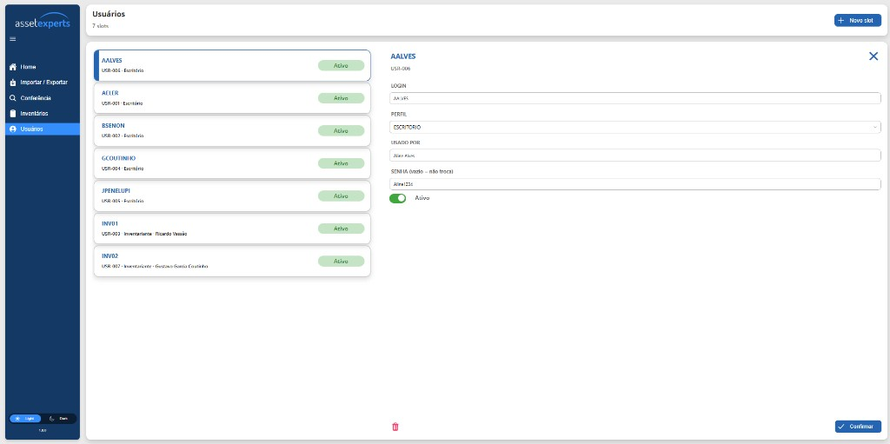

O clique na linha abre o painel.

| Campo | O que faz |
|-------|-----------|
| **LOGIN** | O nome que a pessoa digita. No escritório, por exemplo `AALVES`. No campo, `INV01`. Na criação se edita. No slot que já existe, o login permanece o da lista. |
| **PERFIL** | **ESCRITORIO** ou **INVENTARIANTE**. |
| **USADO POR** | Quem está com aquele login. No campo, é o nome que o tablet mostra na boas-vindas. |
| **SENHA** | A senha do tablet. O aviso diz **vazio = não troca**: deixar em branco no editar mantém a senha atual. |
| Interruptor **Ativo** | Verde, o slot entra. Desligado, o tablet deixa de aceitar esse login. O cadastro continua na lista. |
| **X** | Fecha o painel sem gravar o que ainda não foi confirmado. |
| Lixeira | Abre **Excluir slot?**. |
| **Confirmar** | Grava login, perfil, usado por, senha e o interruptor. |

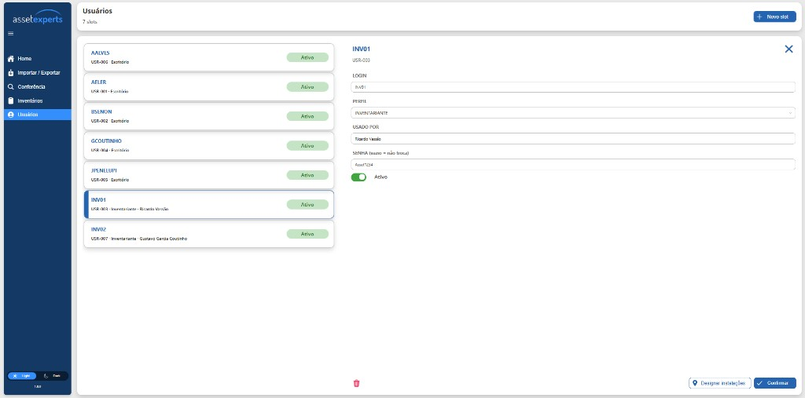

No perfil **INVENTARIANTE** aparece mais um botão: **Designar instalações**. Ele abre as alocações daquele slot. No exemplo, `INV01` está com **Ricardo Vassão**.

Trocar senha, desligar o slot ou mudar a designação pede que o tablet entre de novo. O aparelho avisa quando houver rede.

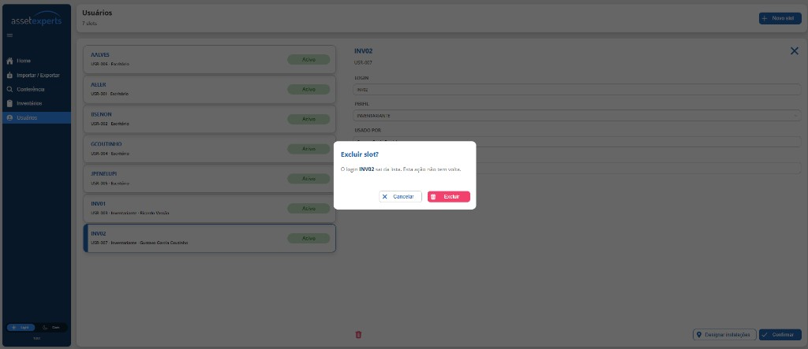

A lixeira pergunta **Excluir slot?**. O texto diz que o login sai da lista e que a ação não tem volta. **Cancelar** ou o **X** mantêm o slot. **Excluir** apaga.

### 3.3 Designar instalações

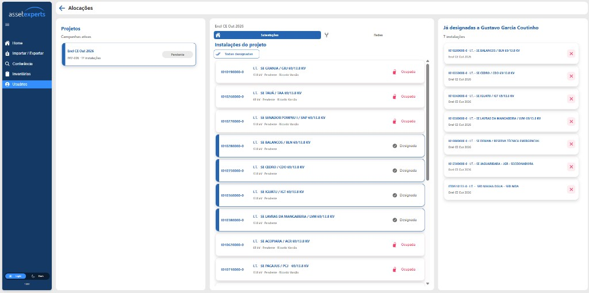

Abre por **Designar instalações**, no slot do inventariante. A seta ao lado de **Alocações** volta para Usuários.

A tela tem três colunas.

| Coluna | O que faz |
|--------|-----------|
| **Projetos** | Campanhas ativas. O clique escolhe o projeto. No exemplo, **Enel CE Out 2026**, código `INV-036`, **17 instalações**, chip **Pendente**. |
| **Instalações do projeto** | As subestações (aba **Subestações**) ou as redes (aba **Redes**). O filtro **Todas designações** restringe a lista. |
| **Já designadas a…** | O que este slot já tem. No exemplo, **Já designadas a Gustavo Garcia Coutinho**, com a contagem. |

No meio, cada card:

| Marca | O que significa |
|-------|-----------------|
| **Ocupada** | Já tem dono. O nome do técnico aparece no card (no exemplo, Ricardo Vassão). Não entra neste slot enquanto estiver ocupada. |
| **Designada** | Está com o slot da coluna da direita. O mesmo código aparece na lista **Já designadas**. |
| **X** na coluna da direita | Tira aquela instalação deste slot. Ela volta a ficar livre para outro. |

Uma subestação fica com um inventariante por vez.

Na aba **Redes**, a instalação ainda livre tem o botão **Adicionar**. **Selecionar todas (N)** marca as livres de uma vez. Ocupada não entra. O **X** da coluna da direita tira a rede deste slot.

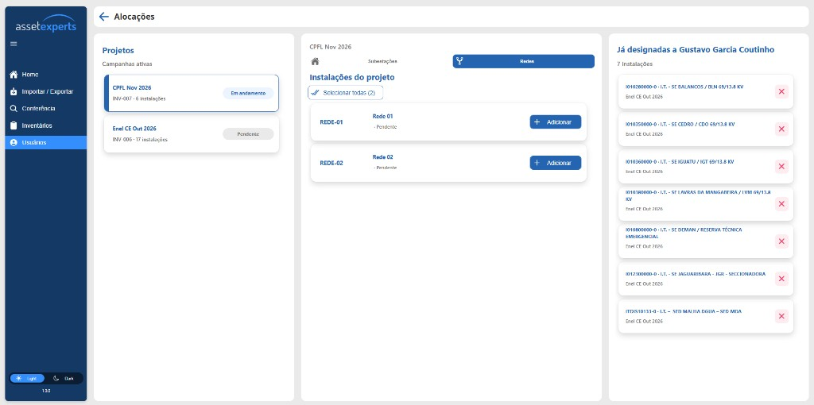

### 3.4 Subestações do projeto

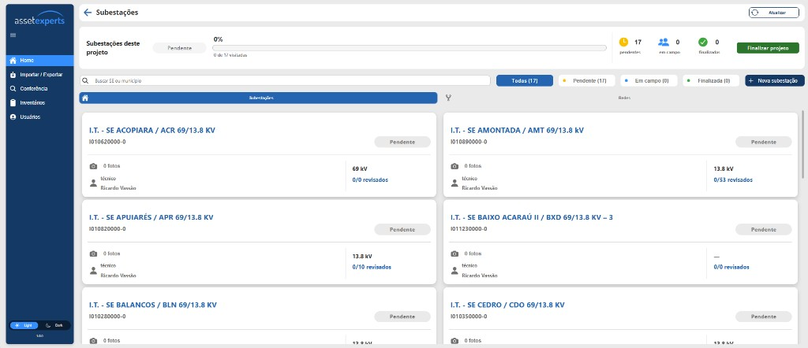

Abre pelo card na Home. A seta ao lado de **Subestações** volta para a Home.

A faixa de cima:

| Parte | O que é |
|-------|---------|
| Título | **Subestações deste projeto**, com o chip de status do projeto (**Pendente**). |
| Barra | Visitadas sobre o total. No exemplo, **0%**, **0 de 17 visitadas**. |
| Três números | Pendentes, em campo e finalizadas. |
| **Finalizar projeto** | Encerra o projeto. Pede confirmação. |

Abaixo:

| Controle | O que faz |
|----------|-----------|
| **Buscar SE ou município** | Filtra os cards. |
| Ícone de filtro | Abre o filtro da lista. |
| **Todas (17)** | Todas as instalações. O número acompanha. |
| **Pendente** | As que ainda não foram levantadas. |
| **Em campo** | As que estão com o inventariante. |
| **Finalizada** | As que o campo já encerrou. |
| **Nova subestação** | Abre o formulário para incluir uma instalação que não veio na planilha. |
| Aba **Subestações** | Os cards de subestação. |
| Aba **Redes** | As redes do mesmo projeto. O título da faixa passa a **Redes deste projeto**. |

Cada card mostra o nome, o código, o chip de status, quantas fotos, o técnico (ou **—** se ninguém está designado), a tensão e **revisados** sobre o total de itens. O clique abre os equipamentos.

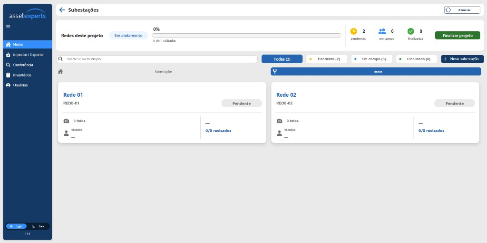

A rede criada sem planilha nasce vazia: **0 fotos** e **0/0 revisados**. No exemplo, **Rede 01** (`REDE-01`) e **Rede 02** (`REDE-02`), as duas **Pendente**. O equipamento da rede entra na visita, como sobra. A pessoa de cada rede é escolhida em **Alocações**.

Quando a lista é recarregada, o canto inferior direito avisa **Subestações atualizadas**. O **X** fecha o aviso.

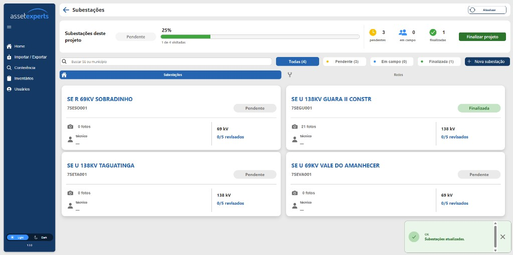

No exemplo menor, a barra está em **25%** (**1 de 4 visitadas**): 3 pendentes, 0 em campo, 1 finalizada. O card finalizado usa o chip verde **Finalizada**.

### 3.5 Nova subestação

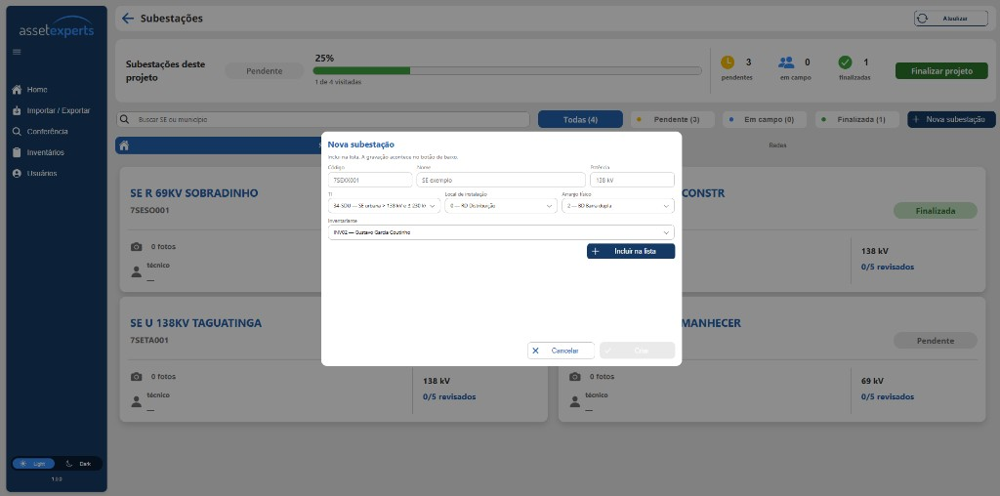

O aviso no topo diz: inclui na lista; a gravação acontece no botão de baixo.

| Campo | O que é |
|-------|---------|
| **Código** | O código da instalação. No exemplo, `7SDX0001`. |
| **Nome** | O nome que aparece no card. |
| **Prefixo** | A tensão, por exemplo **138 kV**. |
| **TI** | Tipo de instalação do local. |
| **Local de instalação** | 0 a 4. No exemplo, **0 — RD Distribuição**. |
| **Arranjo físico** | 1 a 5. No exemplo, **2 — BD Barra dupla**. |
| **Inventariante** | O slot que fica com essa instalação. Pode ficar em branco e ser designado depois. |
| **Incluir na lista** | Desce a instalação para a lista do popup. Ainda não grava. |
| Lixeira na linha | Tira da lista antes de criar. |
| **Cancelar** | Fecha sem gravar. |
| **Criar (n)** | Grava as instalações que estão na lista. Fica apagado enquanto a lista está vazia. Com uma linha, o botão mostra **Criar (1)**. A subestação nasce sem nenhum item. O equipamento entra depois, na visita, por **+ Item**. |

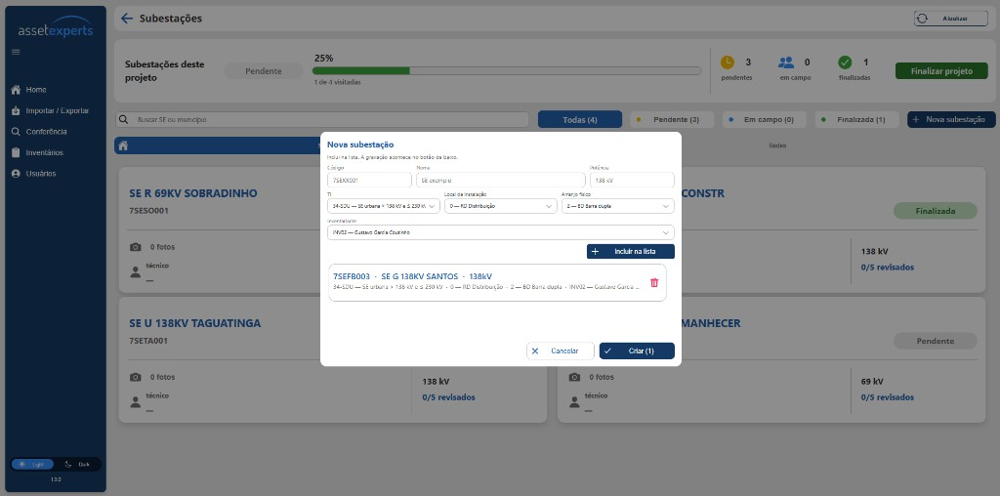

### 3.6 Itens da subestação

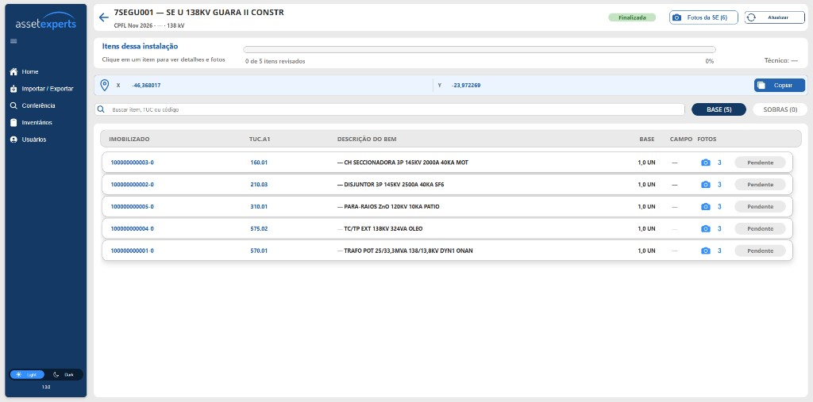

Consulta. O escritório lê o que voltou do campo. Não edita a ficha aqui.

A faixa de cima: código e nome, período, tensão e o chip da subestação (**Finalizada**, no exemplo).

| Controle | O que faz |
|----------|-----------|
| Seta | Volta para as subestações do projeto. |
| **Fotos da SE (6)** | Abre as fotos gerais da instalação. O número é a quantidade. |
| **Atualizar** | Recarrega itens e fotos. |
| Barra | **0 de 5 itens revisados** e a porcentagem. **Técnico** mostra quem levantou, ou **—**. |
| **X** e **Y** | Longitude e latitude da subestação. |
| **Copiar** | Copia a coordenada. |
| **Buscar item, TUC ou código** | Filtra a tabela. |
| **BASE (5)** | Equipamentos que vieram na planilha. |
| **SOBRAS (0)** | Equipamentos achados em campo que não estavam na base. |

Colunas: **IMOBILIZADO**, **TUC.A1**, **DESCRIÇÃO DO BEM**, **BASE** (quantidade da planilha), **CAMPO** (o que foi contado; o traço é item ainda sem contagem), **FOTOS** (o número em cima da câmera) e o chip do item.

O clique na linha abre o painel da direita.

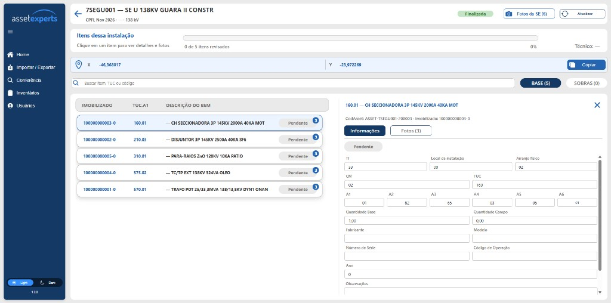

Aba **Informações**: TI, local de instalação, arranjo físico, centro modular, TUC, A1 a A6, quantidade da base, quantidade de campo, fabricante, modelo, número de série, código de operação, ano e observações. O **X** fecha o painel.

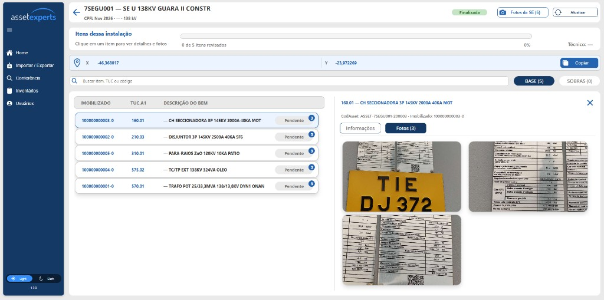

Aba **Fotos** mostra as imagens daquele equipamento. No exemplo, a placa e as folhas do ativo.

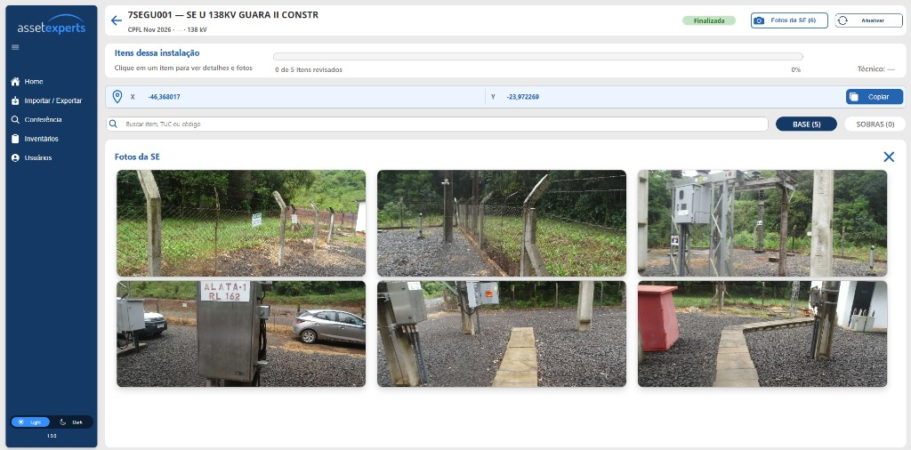

**Fotos da SE** abre a grade das fotos gerais, por cima da lista. O **X** fecha.

O que esta tela mostra antes do **Enviar visita** do tablet é a base importada. Ficha preenchida e foto nova aparecem depois do envio.

### 3.7 Finalizar o projeto

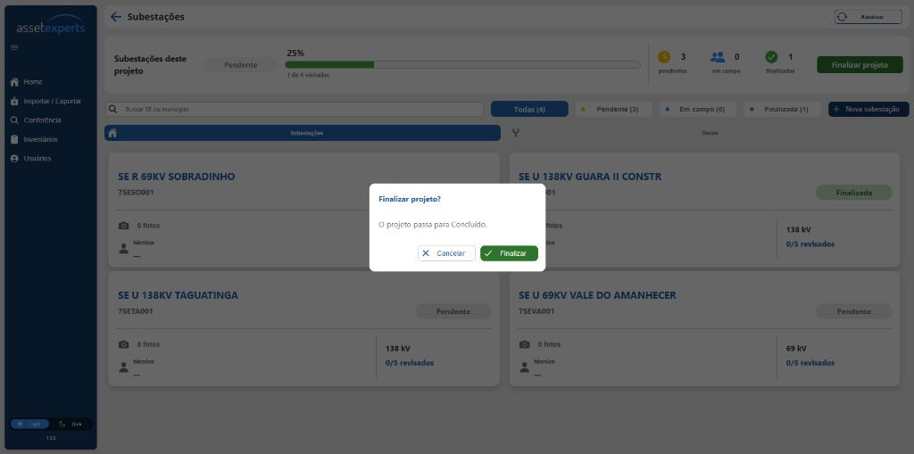

**Finalizar projeto**, na faixa das subestações, pergunta **Finalizar projeto?**. O texto diz que o projeto passa para **Concluído**.

| Botão | O que faz |
|-------|-----------|
| **Cancelar** ou **X** | O projeto continua como está. |
| **Finalizar** | Encerra. **Concluído** só permanece se nenhuma subestação estiver aberta. Se ainda houver instalação fora de **Finalizada**, o projeto fica **Em andamento**. |

Com o projeto **Concluído**, o tablet não reabre subestação. O desktop reabre o projeto; aí a subestação pode ser reaberta.

### 3.8 Importar e exportar

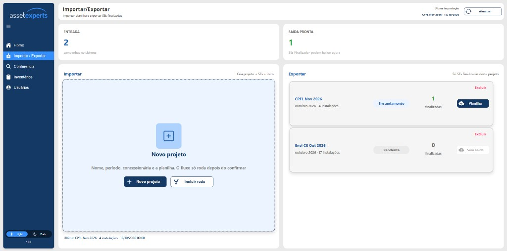

Menu **Importar / Exportar**. O subtítulo é **Importar planilha e exportar SEs finalizadas**.

Dois números no topo:

| Cartão | O que mostra |
|--------|----------------|
| **ENTRADA** | Quantas campanhas existem no sistema. No exemplo, **2**. |
| **SAÍDA PRONTA** | Quantas subestações **Finalizada** já podem ser baixadas. No exemplo, **1**. |

**Atualizar**, no canto, recarrega a tela. Embaixo dele fica a última importação (projeto e data).

O bloco **Importar** diz: cria projeto, subestações e itens. O texto do miolo: nome, período, concessionária e a planilha. O fluxo só roda depois do confirmar.

| Botão | O que faz |
|-------|-----------|
| **Novo projeto** | Abre o painel do projeto novo. |
| **Incluir rede** | Abre a lista de projetos para colocar rede numa campanha que já existe. |

O bloco **Exportar** lista os projetos. O aviso no canto é **Só SEs Finalizadas deste projeto**.

| No card | O que faz |
|---------|-----------|
| Nome, período e instalações | Identificam o projeto. |
| Chip | **Em andamento**, **Pendente**, e assim por diante. |
| Número **finalizadas** | Quantas subestações já podem sair na planilha. |
| **Planilha** | Gera o `.xlsx` das subestações finalizadas. Aparece quando há finalizada e o arquivo ainda não está pronto. |
| **Sem saída** | Não há subestação finalizada. Não há o que baixar. |
| **Planilha pronta** | O arquivo já foi gerado. |
| **Atualizar** | Gera de novo, com o que mudou desde a última planilha. |
| **Baixar** | Abre o arquivo pronto. |
| **Excluir** | Apaga o projeto. Pede confirmação. Não desfaz: somem subestações, equipamentos, fotos, designações, a pasta em `Projetos` e as planilhas daquele código. |

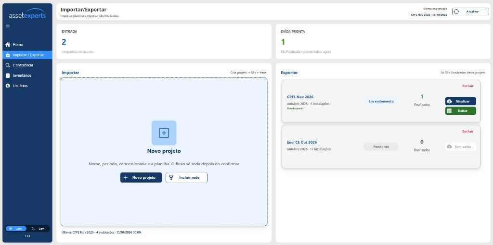

No exemplo, **CPFL Nov 2026** está **Em andamento**, com **1** finalizada e a planilha pronta (**Atualizar** e **Baixar**). **Enel CE Out 2026** está **Pendente**, com **0** finalizadas e **Sem saída**.

Enquanto a importação roda, o card na Home fica com o chip **Importando**.

#### Novo projeto

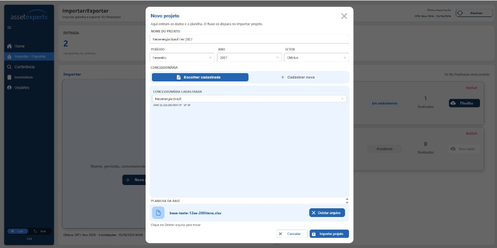

O painel avisa: aqui entram os dados e a planilha. O fluxo só dispara no **Importar projeto**.

| Campo | O que é |
|-------|---------|
| **NOME DO PROJETO** | O nome do card. No exemplo, **Neoenergia Brasil Fev 2027**. |
| **PERÍODO** | O mês. No exemplo, **Fevereiro**. |
| **ANO** | No exemplo, **2027**. |
| **SETOR** | No exemplo, **Elétrico**. |
| **Escolher cadastrada** | Usa uma concessionária que já está no sistema. A lista mostra nome, CNPJ e UF. |
| **Cadastrar nova** | Abre o cadastro da concessionária neste mesmo painel. |
| **PLANILHA DA BASE** | O `.xlsx`. No exemplo, `base-teste-12ee-200itens.xlsx`. |
| **Deletar arquivo** | Tira a planilha para escolher outra. O texto embaixo diz para usar esse botão na troca. |
| **Cancelar** ou **X** | Fecha sem importar. |
| **Importar projeto** | Dispara a carga. |

A importação cria o projeto em **Pendente**, uma subestação por código ODI, um equipamento por linha e as pastas de foto (**Visão geral** dentro de cada subestação).

#### Incluir rede

A rede entra no projeto que já existe. Não nasce outro card na Home.

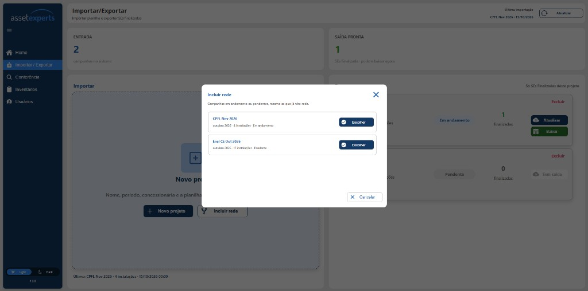

O aviso: campanhas em andamento ou pendentes, mesmo as que já têm rede.

| Controle | O que faz |
|----------|-----------|
| Card | Nome, período, instalações e o status. |
| **Escolher** | Trava aquele projeto e abre o modo da rede. |
| **Cancelar** ou **X** | Fecha sem incluir. |

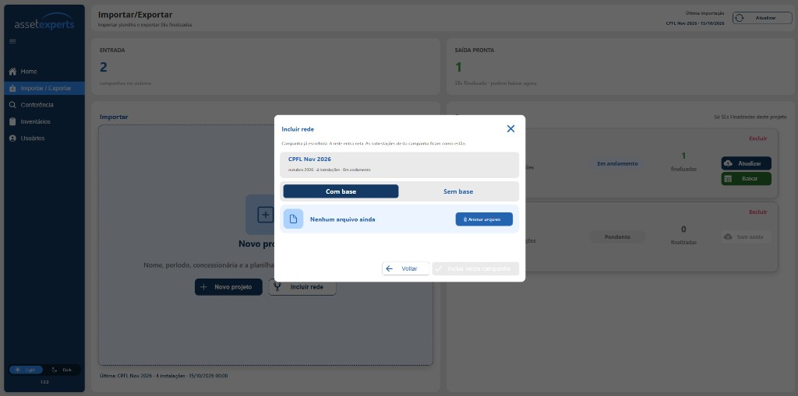

O texto confirma: a campanha já está escolhida, a rede entra nela, e as subestações dessa campanha ficam como estão.

| Controle | O que faz |
|----------|-----------|
| **Com base** | A rede vem de uma planilha. |
| **Sem base** | A rede nasce vazia. O equipamento entra depois, na visita. |
| **Anexar arquivo** | Escolhe o `.xlsx` da rede. Enquanto estiver **Nenhum arquivo ainda**, **Incluir nesta campanha** fica apagado. |
| **Voltar** | Retorna à lista de projetos. |
| **Incluir nesta campanha** | Sobe a planilha para o projeto escolhido. |

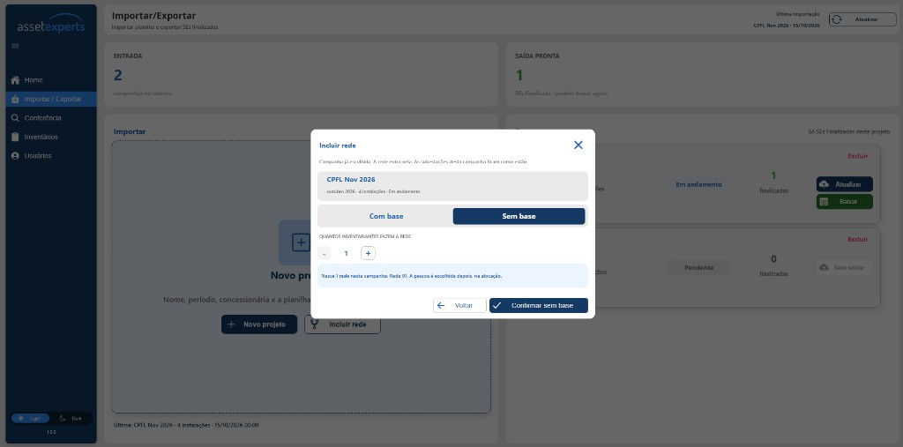

| Controle | O que faz |
|----------|-----------|
| **QUANTOS INVENTARIANTES ENTRAM A REDE** | O **−** e o **+** mudam a quantidade. Cada um vira uma rede agora. |
| Aviso | Com **1**, nasce **Rede 01**. A pessoa é escolhida depois, na alocação. A numeração continua do que já existe: se já houver **Rede 01**, a próxima é **Rede 02**. |
| **Voltar** | Retorna à lista de projetos. |
| **Confirmar sem base** | Grava as redes vazias, em **Pendente**, com **0** itens. |

### 3.9 Onde ficam as fotos

Biblioteca **Projetos**:

```text
Projetos/
  {NomeDoProjeto}_{código}/
    {CodSE} - {Nome da SE}/
      Visão geral/          fotos da instalação
      {imobilizado}/        fotos do equipamento
```

A pasta do equipamento leva só o número exclusivo: imobilizado e, se não houver, o código do ativo. A descrição do bem não entra no nome da pasta.

A importação cria a raiz, a pasta de cada subestação e **Visão geral**. A pasta do equipamento nasce quando a visita envia a foto daquele item.


## 4. Campo

O tablet usa a conta Microsoft da empresa. O prestador entra com o slot que o escritório cadastrou. O exemplo abaixo é o slot `INV01`, no projeto **Enel CE Out 2026**.

Salvar a ficha grava no aparelho. O escritório só vê ficha e foto depois de **Enviar visita**, com sinal.

### 4.1 Entrar

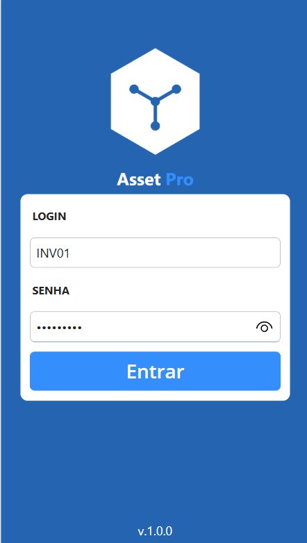

| Controle | O que faz |
|----------|-----------|
| **LOGIN** | O slot. No exemplo, `INV01`. |
| **SENHA** | A senha cadastrada em Usuários. O olho à direita mostra ou esconde o que foi digitado. |
| **Entrar** | Confere login e senha. Se os dois batem, abre a lista de projetos. |

Login ou senha errados permanecem nesta tela.

### 4.2 Escolher o projeto

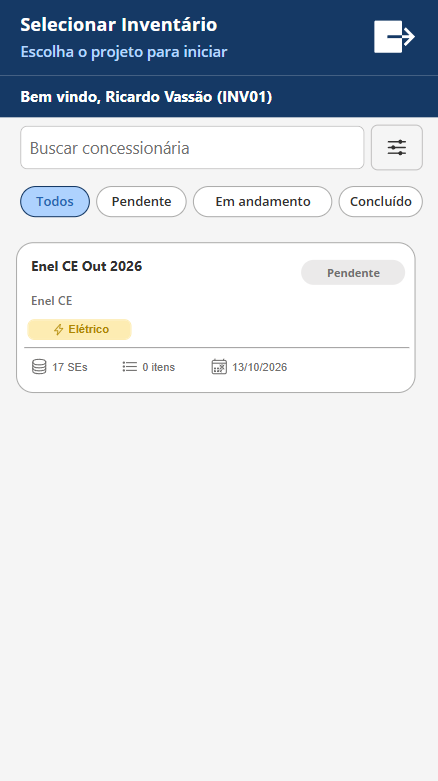

A faixa de cima cumprimenta quem está com o slot: **Bem vindo, Ricardo Vassão (INV01)**.

| Controle | O que faz |
|----------|-----------|
| Seta no canto superior direito | Sai do slot e volta para o login. |
| **Buscar concessionária** | Filtra a lista pelo nome da concessionária. |
| Ícone de filtros, à direita da busca | Abre o filtro da lista. |
| **Todos** | Mostra os projetos designados a este slot, em qualquer status. |
| **Pendente** | Só os que ainda não tiveram visita enviada. |
| **Em andamento** | Os que já tiveram pelo menos uma visita enviada. |
| **Concluído** | Os que o escritório já encerrou. |
| Card do projeto | Abre aquele projeto. No exemplo: **Enel CE Out 2026**, chip **Pendente**, setor **Elétrico**, **17 SEs**, **0 itens** (ainda não baixou a base) e a data **13/10/2026**. |

O slot **Inventariante** só vê projeto designado a ele. O slot **Escritório**, no mesmo tablet, vê todas as campanhas e todas as subestações.

### 4.3 Home do projeto, antes de baixar

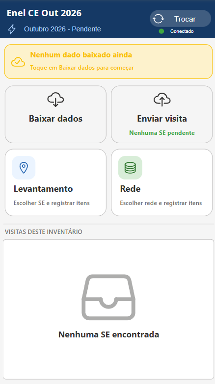

| Controle | O que faz |
|----------|-----------|
| **Trocar** | Volta para a lista de projetos sem sair do slot. |
| **Conectado** | O ponto verde indica que o tablet está com rede. Sem rede, o envio e o download não sobem. |
| Faixa amarela | **Nenhum dado baixado ainda.** A base deste projeto ainda não está no aparelho. |
| **Baixar dados** | Com sinal, traz as subestações designadas, os equipamentos e as fotos que já tinham sido enviadas. |
| **Enviar visita** | Sobe o que foi finalizado neste aparelho. Antes de finalizar alguma subestação, o texto embaixo fica **Nenhuma SE pendente**. |
| **Levantamento** | Abre a lista de subestações para registrar os itens. |
| **Rede** | Abre a lista de redes deste projeto. A figura abaixo é a tela desenhada: esse bloco ainda não está no tablet. |
| **Visitas deste inventário** | As subestações deste projeto. Vazia, mostra **Nenhuma SE encontrada**, porque a base ainda não desceu. |

Toque em **Baixar dados** com sinal, antes de ir para a instalação. Sem esse passo, a visita não tem com o que comparar.

### 4.4 Home do projeto, depois de baixar

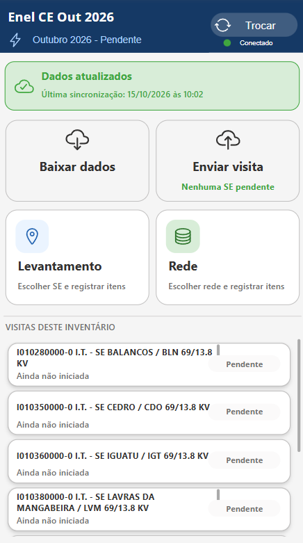

A faixa fica verde: **Dados atualizados**, com a hora da última sincronização. No exemplo, **15/10/2026 às 10:02**.

**Enviar visita** continua **Nenhuma SE pendente**: baixar não gera envio. O envio só aparece quando uma subestação foi finalizada.

Em **Visitas deste inventário**, cada card traz o código e o nome da subestação, o texto **Ainda não iniciada** e o chip **Pendente**. O toque no card abre aquela subestação. **Levantamento** abre a mesma lista, com busca e filtro.

### 4.5 Escolher a subestação

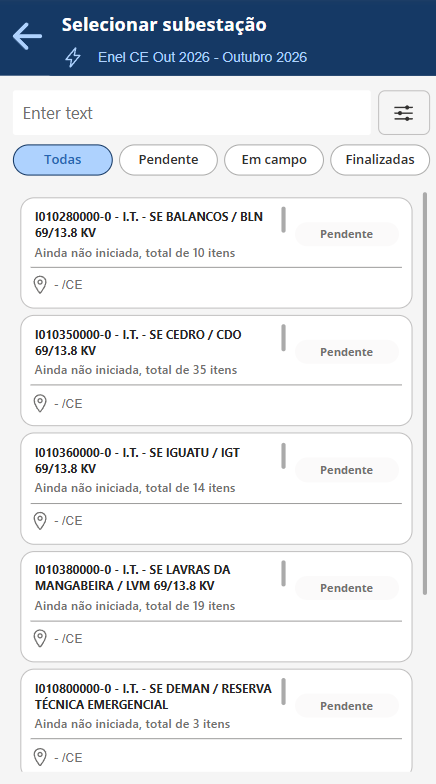

| Controle | O que faz |
|----------|-----------|
| Seta azul, à esquerda | Volta para a home do projeto. |
| Caixa **Enter text** | Busca pelo código ou pelo nome da subestação. |
| Ícone de filtros | Abre o filtro da lista. |
| **Todas** | Todas as subestações designadas neste projeto. |
| **Pendente** | As que ainda não foram levantadas. |
| **Em campo** | As que estão abertas no levantamento. |
| **Finalizadas** | As que o inventariante já encerrou. |
| Card | Código, nome, o andamento (**Ainda não iniciada, total de 10 itens**) e o chip de status. O alfinete embaixo é a coordenada. **-/CE** significa que a coordenada ainda não foi coletada; **CE** é a UF. |

O toque no card abre a lista de equipamentos daquela subestação.

### 4.6 Lista de equipamentos

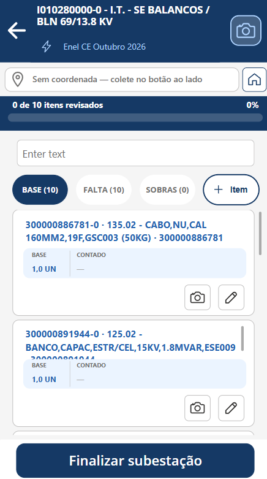

A faixa de cima é a subestação. No exemplo, **I010280000-0 · SE BALANCOS / BLN 69/13.8 KV**, projeto **Enel CE Outubro 2026**.

| Controle | O que faz |
|----------|-----------|
| Seta | Volta para a lista de subestações. |
| Câmera, canto superior direito | Abre as fotos gerais da instalação. O número verde em cima dela é quantas fotos gerais já existem. |
| Faixa do alfinete | Mostra a coordenada. Sem coleta, o texto é **Sem coordenada — colete no botão ao lado**. |
| Casa, à direita da coordenada | Abre o popup **Local** (tipo de instalação, local, arranjo e coordenada). |
| Barra **0 de 10 itens revisados** | Quantos equipamentos desta subestação já foram salvos. A porcentagem acompanha a barra. |
| Caixa **Enter text** | Busca na lista (descrição, TUC, imobilizado, código). |
| **BASE (10)** | Equipamentos que vieram na planilha. O número é a quantidade de linhas. |
| **FALTA (10)** | Os que ainda não foram inventariados. No começo, coincide com a base. |
| **SOBRAS (0)** | Equipamentos achados no pátio que não estavam na planilha. |
| **+ Item** | Abre a ficha de uma sobra. |
| Card do item | Imobilizado, TUC, descrição e o IdUC no fim da linha. **BASE** é a quantidade da planilha. **CONTADO** é o que o inventariante achou. O traço significa que ainda não salvou. |
| Câmera no card | Fotos daquele equipamento. O número verde é quantas já foram tiradas. O teto do equipamento é **5**. |
| Lápis no card | Abre a ficha do equipamento. |
| **Finalizar subestação** | Encerra a instalação e coloca na fila de envio. Pede confirmação. |

A lista segue a ordem da planilha.

### 4.7 Local, tipo de instalação e coordenada

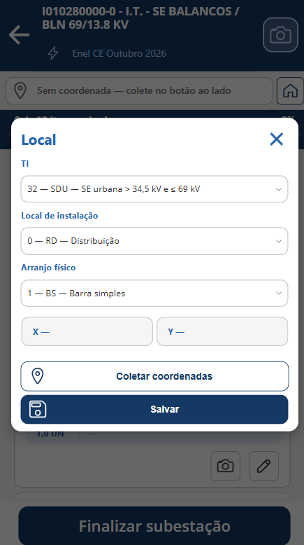

Abre pelo ícone da casa, na faixa da coordenada. Vale para a subestação inteira. O centro modular fica na ficha do equipamento.

| Controle | O que faz |
|----------|-----------|
| **TI** | Tipo de instalação do local. Um código para todos os equipamentos dali. No exemplo, **32 — SDU — SE urbana > 34,5 kV e ≤ 69 kV**. Se a planilha trouxe, entra preenchido. Se veio em branco, o inventariante escolhe aqui. Com a subestação aberta, o valor pode ser corrigido. |
| **Local de instalação** | 0 RD, 1 DIT-RPC, 2 RBSE, 3 RBNI ou 4 DIT-RCDM. No exemplo, **0 — RD — Distribuição**. |
| **Arranjo físico** | 1 BS, 2 BD, 3 BDDD, 4 BPT ou 5 DJM. No exemplo, **1 — BS — Barra simples**. |
| **X** e **Y** | Longitude e latitude. Ficam com traço até a coleta. |
| **Coletar coordenadas** | Grava a posição do tablet em X e Y. Sem GPS no momento, a coordenada sobe no envio da visita. |
| **Salvar** | Grava TI, local, arranjo e coordenada no aparelho. |
| **X** azul, no canto do popup | Fecha sem aplicar o que ainda não foi salvo. |

Subestação finalizada abre este popup só para leitura.

### 4.8 Fotos gerais da subestação

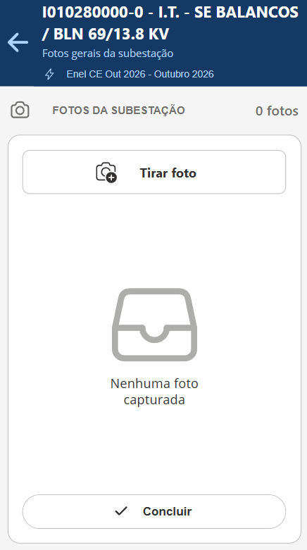

Abre pela câmera do canto superior da lista. O título é **Fotos gerais da subestação**.

| Controle | O que faz |
|----------|-----------|
| Seta | Volta para a lista de equipamentos. |
| **Tirar foto** | Abre a câmera. Estas fotos são do pátio, da placa e do entorno. Vão para a pasta **Visão geral** e não entram no limite de 5 do equipamento. |
| Contador **0 fotos** | Quantas fotos gerais desta subestação já estão no aparelho. |
| **Concluir** | Fecha a tela e volta para a lista. |
| Toque na miniatura | Abre a foto. |
| **Excluir esta foto?** | O toque para apagar pede confirmação. Mostra a miniatura e a data (**Capturada em 15/10/2026 10:05**). **Cancelar** ou o **X** mantêm a foto. **Excluir** apaga. |

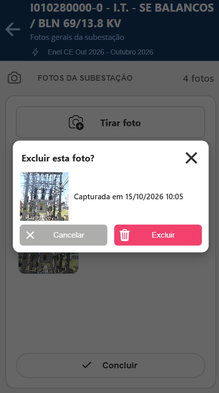

### 4.9 Ficha de um equipamento da base

O lápis do card abre a ficha. O título é o imobilizado, a TUC e a descrição. Embaixo, o código da subestação e o projeto.

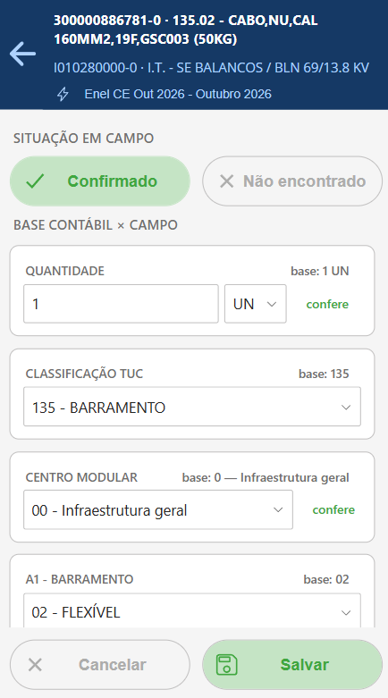

**Situação em campo** tem dois botões:

| Botão | O que faz |
|-------|-----------|
| **Confirmado** | O equipamento foi achado. A quantidade digitada vai para **CONTADO**. A quantidade da base permanece como veio na planilha. |
| **Não encontrado** | O equipamento não está no pátio. A quantidade vai para 0. A quantidade da base não zera. |

Cada bloco mostra, à direita, o valor da base (**base: 1 UN**, **base: 135**, **base: 0 — Infraestrutura geral**, **base: 02**).

| Campo | O que é |
|-------|---------|
| **QUANTIDADE** | O que foi contado, com a unidade (UN, M, e assim por diante). **confere** (verde) quando o contado é igual à base. **diverge** (vermelho) quando é diferente. |
| **CLASSIFICAÇÃO TUC** | Tipo de unidade de cadastro. No exemplo, **135 - BARRAMENTO**. |
| **CENTRO MODULAR** | Código 0 a 9 do equipamento. Muda de item para item. No exemplo, **00 - Infraestrutura geral**. |
| **A1**, **A2**… | Atributos daquele TUC. A1 é o subtipo. No exemplo, **02 - FLEXÍVEL**. |

| Botão | O que faz |
|-------|-----------|
| **Cancelar** | Fecha a ficha e descarta o que ainda não foi salvo. |
| **Salvar** | Grava no tablet. Não envia ao escritório e não confirma os outros itens da lista. |

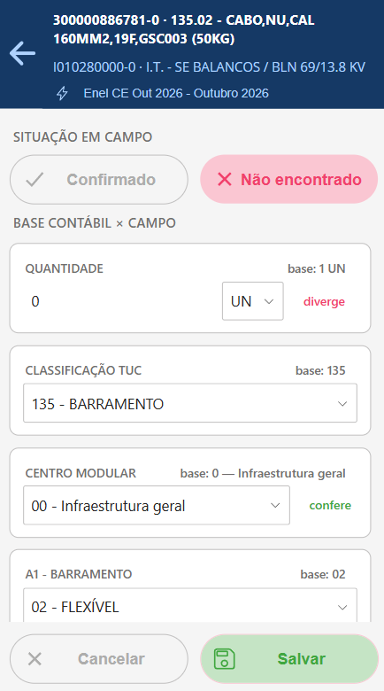

Com **Não encontrado** marcado, a quantidade fica **0** e o comparador mostra **diverge**, porque a base continua **1 UN**.

A ficha segue para baixo com fabricante, modelo, número de série, ano, bay, código de operação, reserva e observações. Reserva é um sim ou não daquele equipamento.

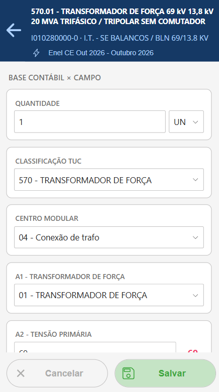

No exemplo do transformador: quantidade **1 UN**, TUC **570 - TRANSFORMADOR DE FORÇA**, centro modular **04 - Conexão de trafo**, A1 e A2 (**TENSÃO PRIMÁRIA**). **Salvar** grava. **Cancelar** volta sem gravar.

Depois de salvar, a lista mostra o resultado:

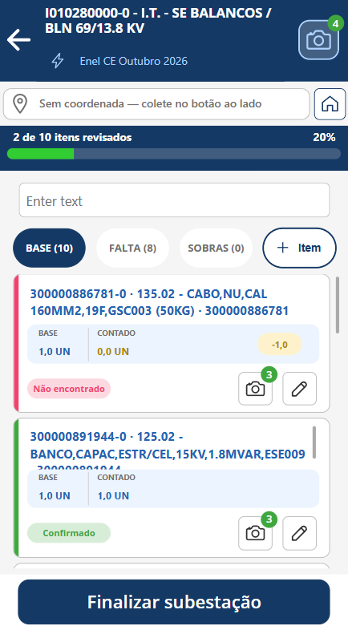

- A barra sobe. No exemplo, **2 de 10 itens revisados**, **20%**.
- O item não encontrado fica com tarja vermelha, chip **Não encontrado**, **CONTADO 0,0 UN** e o selo **-1,0** (a diferença em relação à base).
- O item confirmado fica com chip **Confirmado** e **CONTADO 1,0 UN**.
- A câmera do card ganha o número de fotos daquele item (aqui, **3**). A câmera de cima ganha o número das fotos gerais (aqui, **4**).

### 4.10 Aba Falta

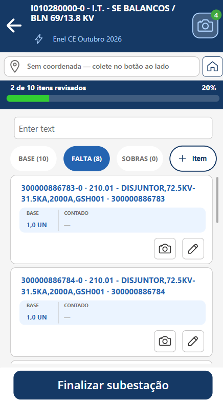

**FALTA (8)** lista só o que ainda não foi salvo. Some daqui o que já está Confirmado ou Não encontrado. **BASE (10)** continua com a planilha inteira. **SOBRAS (0)** continua vazio enquanto ninguém usar **+ Item**.

### 4.11 Sobra

Equipamento que está no pátio e não veio na planilha:

1. **+ Item**.
2. Preenche a mesma ficha (quantidade, TUC, centro modular, A1 em diante).
3. **Salvar**. A quantidade encontrada é a que foi contada, porque não havia quantidade de base.
4. O item aparece na aba **SOBRAS**. A câmera do card segue o teto de **5** fotos.

O código da sobra nasce `SOBRA-{código da SE}-{nn}`.

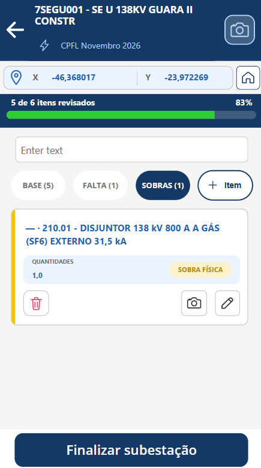

No exemplo, **7SEGU001 · SE U 138KV GUARA II CONSTR**, campanha **CPFL Novembro 2026**. A aba **SOBRAS (1)** está selecionada. **BASE** continua com os 5 da planilha. **FALTA (1)** é o que da base ainda não foi salvo. A barra conta os revisados: **5 de 6 itens**, **83%**.

O card da sobra não tem imobilizado (o traço no começo da linha). Mostra a TUC e a descrição. No exemplo, **210.01** e o disjuntor a gás. O bloco é **QUANTIDADES**, com **1,0**, porque não havia quantidade de base para comparar. O chip amarelo diz **SOBRA FÍSICA**. A tarja amarela na esquerda marca o mesmo.

| Controle no card | O que faz |
|------------------|-----------|
| Lixeira | Tira essa sobra da lista. |
| Câmera | Fotos desse equipamento. Teto de **5**. |
| Lápis | Abre a ficha de novo. |

### 4.12 Desmembrar

Quando um registro da base representa mais de um lance físico (no exemplo, **24 M** de cabo num único código):

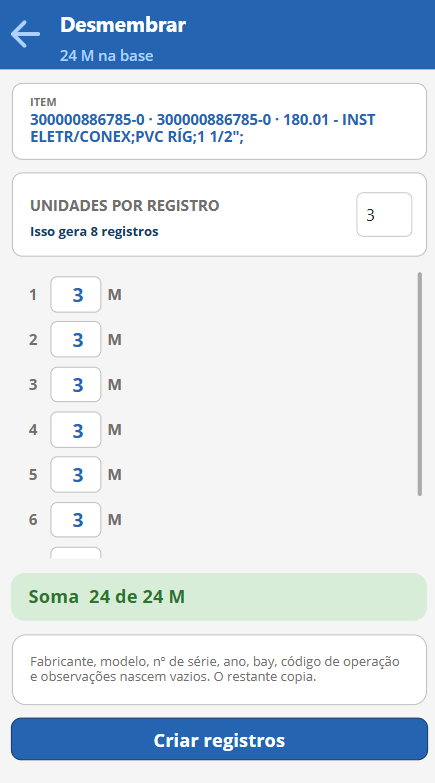

| Controle | O que faz |
|----------|-----------|
| Seta | Volta sem criar os registros. |
| Cartão **ITEM** | O código que está sendo partido. |
| **UNIDADES POR REGISTRO** | Quanto entra em cada registro novo. No exemplo, **3**. O texto ao lado diz **Isso gera 8 registros** (24 ÷ 3). |
| Linhas **1**, **2**, **3**… | Uma linha por registro, com a quantidade e a unidade (**3 M**). Dá para ajustar linha a linha. |
| **Soma 24 de 24 M** | A soma das linhas precisa fechar a quantidade da base. O fundo verde indica que fechou. |
| Aviso | Fabricante, modelo, número de série, ano, bay, código de operação e observações nascem vazios. O restante copia do registro original. |
| **Criar registros** | Grava as partes no tablet. As partes novas nascem em aberto, sem o chip Confirmado. |

### 4.13 Finalizar a subestação

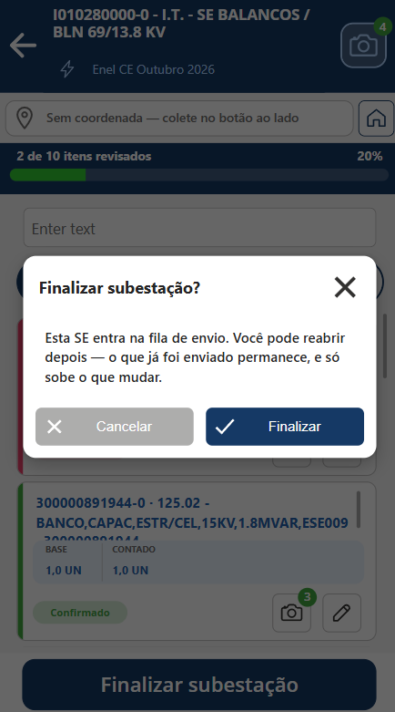

**Finalizar subestação**, no rodapé da lista, abre a pergunta **Finalizar subestação?**

O aviso diz: esta SE entra na fila de envio. Dá para reabrir depois. O que já foi enviado permanece, e só sobe o que mudar.

| Botão | O que faz |
|-------|-----------|
| **Cancelar** | Fecha o aviso. A subestação continua aberta. |
| **X** | O mesmo que cancelar. |
| **Finalizar** | Encerra a subestação neste aparelho e coloca na fila. Ainda não sobe para o escritório. |

Não é obrigatório zerar a aba **Falta** para finalizar. O que ficar sem salvar sobe como não revisado.

Depois de finalizar, a lista de subestações troca o chip:

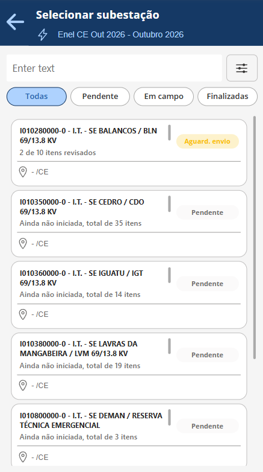

O card da SE BALANCOS sai de **Pendente** para **Aguard. envio** e mostra **2 de 10 itens revisados**. As outras seguem **Pendente**.

Na home do projeto, **Enviar visita** passa a dizer **1 SE pendente**:

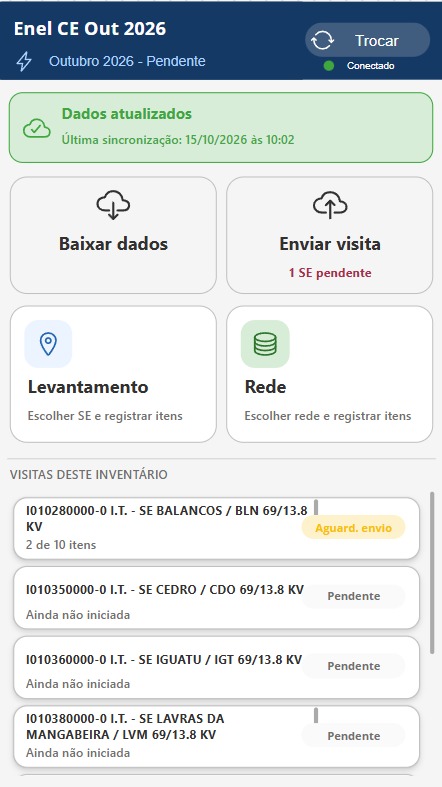

O mesmo chip **Aguard. envio** aparece em **Visitas deste inventário**.

### 4.14 Reabrir

Enquanto o projeto não estiver **Concluído**, a subestação finalizada pode voltar para edição. Abra o card **Aguard. envio**. O rodapé, que era **Finalizar subestação**, vira **Reabrir subestação**.

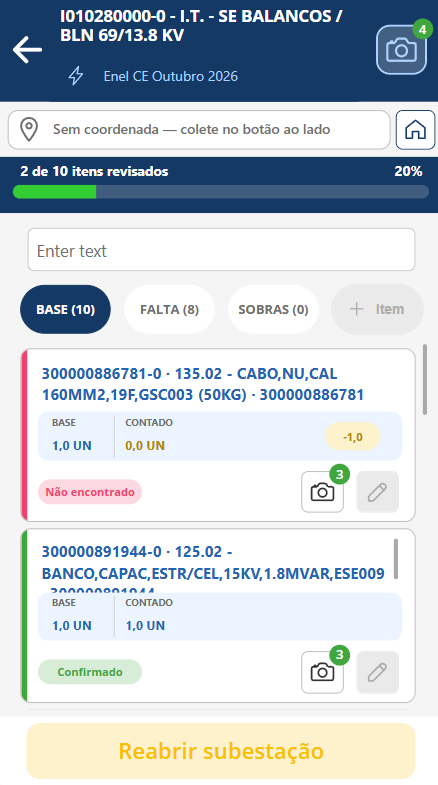

O toque abre a confirmação:

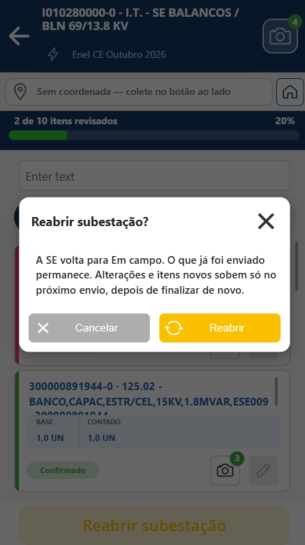

O aviso diz: a SE volta para **Em campo**. O que já foi enviado permanece. Alterações e itens novos sobem só no próximo envio, depois de finalizar de novo.

| Botão | O que faz |
|-------|-----------|
| **Cancelar** ou **X** | Mantém **Aguard. envio**. |
| **Reabrir** | Devolve a subestação para o levantamento. O rodapé volta a ser **Finalizar subestação**. |

Com o projeto **Concluído** no escritório, o tablet não reabre.

### 4.15 Enviar a visita

Com sinal, na home do projeto:

1. Confira o ponto **Conectado** e o texto **1 SE pendente** (ou mais) embaixo de **Enviar visita**.
2. Toque em **Enviar visita**.
3. Fichas e fotos das subestações **Aguard. envio** sobem. O projeto passa a **Em andamento**.
4. As fotos aparecem nas pastas do SharePoint em seguida.

Sem sinal, o botão não completa o envio. A fila continua no aparelho até haver rede.

### 4.16 Trocar de prestador no mesmo tablet

1. O escritório altera o slot (senha, “usado por” ou designação).
2. Com rede, o tablet pede novo login.
3. O próximo prestador entra com o slot dele, escolhe o projeto e toca em **Baixar dados**. Ele só recebe as subestações designadas a esse slot.

### 4.17 Rede

O botão **Rede** já está na home do projeto. A lista que ele abre ainda não está no tablet. A figura é a tela no mesmo recorte de **Selecionar subestação**, com as redes que o escritório criou naquela campanha.

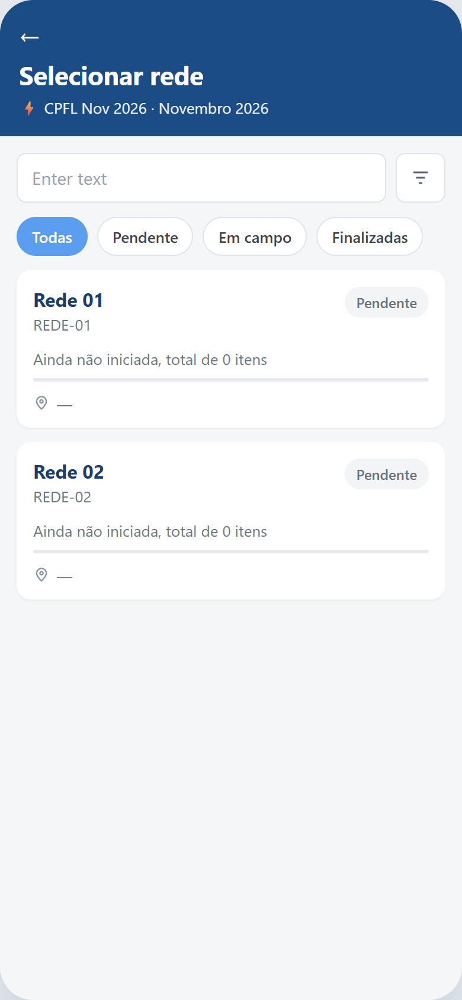

No exemplo, **CPFL Nov 2026**, as duas redes criadas sem base.

| Controle | O que faz |
|----------|-----------|
| Seta | Volta para a home do projeto. |
| **Enter text** | Busca pelo nome ou pelo código da rede. |
| Ícone de filtros | Abre o filtro da lista. |
| **Todas**, **Pendente**, **Em campo**, **Finalizadas** | O mesmo recorte da lista de subestações. |
| Card | Nome (**Rede 01**), código (**REDE-01**), chip **Pendente** e **0 itens**, porque a rede sem planilha nasce vazia. O alfinete fica em traço até haver coordenada. |

**Visitas deste inventário**, na home, continua só com subestação. A rede não entra nessa lista.

O toque no card abre o levantamento daquela rede. O equipamento que não veio na base entra por **+ Item**, como sobra. A coordenada da rede é do item.

---

## 5. Ordem do dia a dia

1. Escritório cadastra o slot.
2. Escritório importa o `.xlsx`.
3. Escritório designa as subestações.
4. Inventariante, com sinal, baixa os dados.
5. Em campo, levanta, fotografa e finaliza cada subestação.
6. Com sinal, envia a visita.
7. Escritório confere subestações, fotos e fichas.
8. Com todas as subestações finalizadas, escritório finaliza o projeto.
9. Escritório baixa a planilha em `Exportacoes` e as fotos em `Projetos`.
